# SVC Admin — 单机六服务托管面板

SVC Admin 是一套面向中小型内网运维场景的 **Ubuntu 24.04 单机服务托管面板**。它使用 apt 原生部署 FTP、DNS 代理、RADIUS、Syslog、SNMP 和 NTP 六项服务，并通过统一的 Web 界面完成配置、状态查看、连接自测、权限控制与操作审计。整个方案不依赖容器，适合资源有限、希望快速交付且便于长期维护的服务器环境。

面板将高频运维操作集中到一个入口：管理员可以在同一套页面中维护虚拟 FTP 用户、DNS 转发与本地解析、RADIUS 用户和 NAS 客户端、日志接收规则、SNMP 监控主机以及 NTP 授时策略。配置变更经过校验、备份、应用、健康检查和失败回滚，降低直接修改系统配置文件带来的风险。

> 完整的架构、接口清单、数据模型、安全机制与运维说明见 [docs/开发与运维文档.md](docs/开发与运维文档.md)。

## 核心功能

- **六项服务统一管理**：FTP、DNS、RADIUS、Syslog、SNMP、NTP 共用一套导航、状态展示、配置表单和自测入口。
- **可视化运行状态**：总览页实时展示 CPU、内存、磁盘、负载和网络吞吐趋势，同时汇总服务运行状态与最近操作。
- **安全变更闭环**：配置先写入 staging，再交给 root 助手完成备份、校验、原子安装、服务重启、健康检查和失败回滚。
- **主机与接口监控**：添加 SNMP v2c/v3 被监控主机，查看系统信息、内存、Swap、磁盘和接口流量，历史数据保留 24 小时。
- **角色与操作审计**：管理员与只读账号权限分离，所有关键配置动作记录操作者、服务、详情和执行结果。
- **本地 dry-run 演示**：无需修改本机系统服务即可启动完整界面，用于二次开发、截图和功能验收。

| 服务 | 实现 | 面板能力 |
|---|---|---|
| FTP | pure-ftpd-mysql（虚拟用户存 MariaDB，FTPS） | 用户/配额/限速/只读、TLS 与被动端口、登录自测 |
| DNS 代理 | dnsmasq（转发 + 缓存 + 本地记录 + 屏蔽） | 上游/分流、A/CNAME、屏蔽列表、解析测试、查询日志 |
| RADIUS | FreeRADIUS 3.2 + MySQL 后端 | 用户/组/属性、NAS 客户端、在线会话、radtest 自测 |
| Syslog | rsyslog → MariaDB（ommysql） | 接收网段、过滤/转发规则、检索、保留清理 |
| SNMP | net-snmp snmpd（v2c + v3） | 团体名/来源网段/v3 用户/Trap 目标、snmpget 自测；**添加被监控主机**并每 60 秒轮询，子菜单进入详情页查看内存、磁盘、接口流量 |
| NTP | chrony（替代 systemd-timesyncd） | 上游服务器、允许授时网段、本地层级；查看同步状态与时间源列表 |

## 界面预览

以下截图来自本地 `dry-run` 演示环境，使用示例数据展示实际页面布局和主要交互。部署到服务器后，页面会读取真实服务状态与数据库数据。

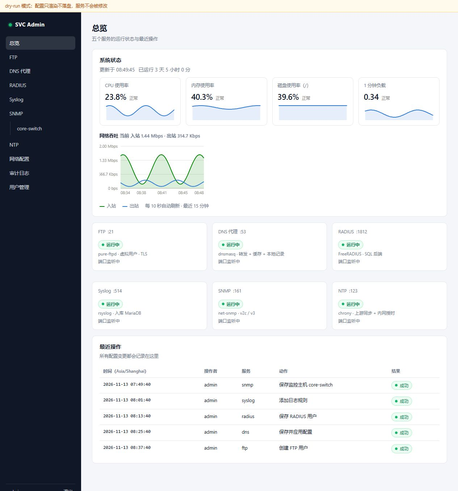

### 核心模块

| 模块 | 功能与页面 |
|---|---|
| **FTP 服务**<br>全局 TLS、被动端口、连接限制、虚拟用户、配额、限速与登录自测。 | [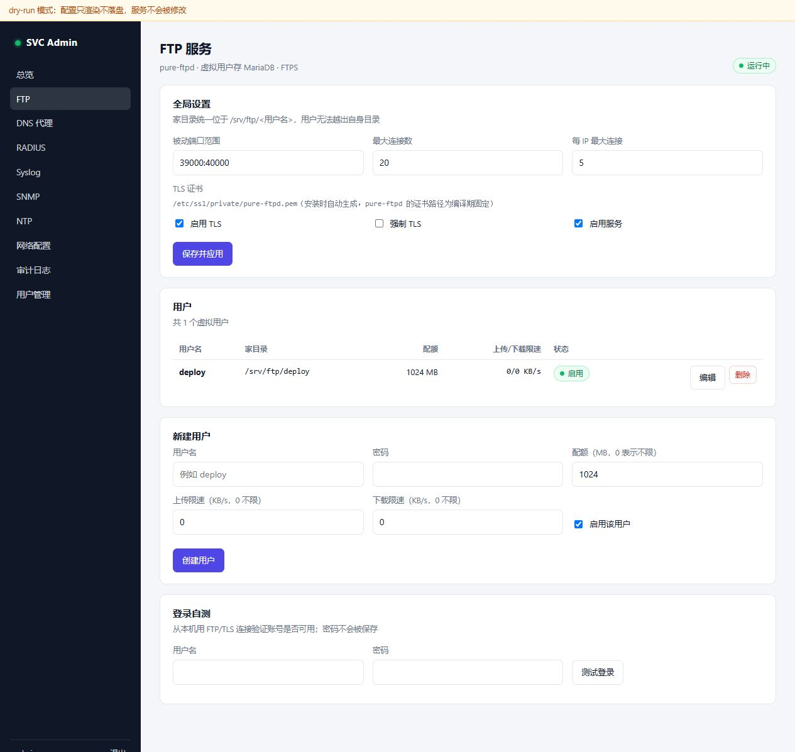](docs/screenshots/ftp.jpg) |
| **DNS 代理**<br>上游与缓存、按域名分流、本地 A/CNAME、域名屏蔽、查询日志与解析测试。 | [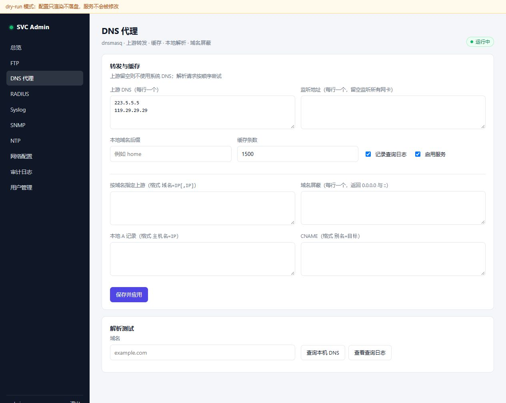](docs/screenshots/dns.jpg) |
| **RADIUS 服务**<br>用户、用户组、回复属性、NAS 客户端、在线会话与认证自测。 | [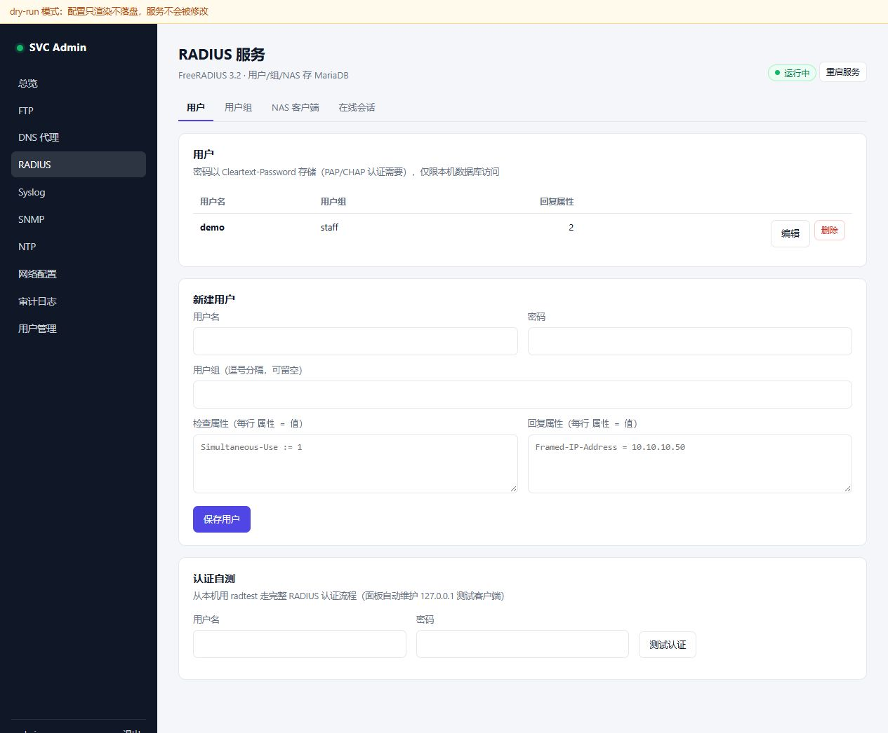](docs/screenshots/radius.jpg) |
| **Syslog 服务**<br>接收网段、过滤与转发规则、日志检索、自动刷新和保留清理。 | [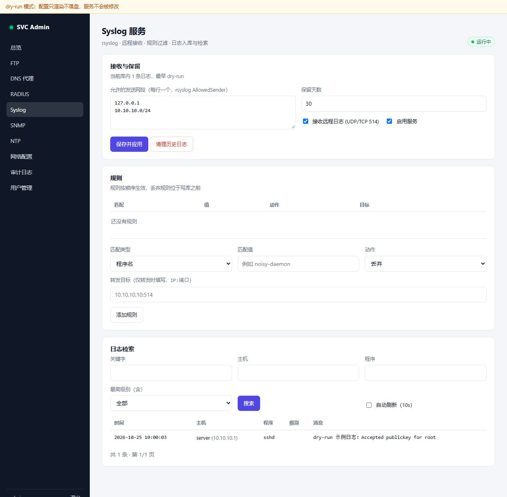](docs/screenshots/syslog.jpg) |
| **SNMP 服务**<br>本机 snmpd 配置、v2c/v3 用户、Trap 目标、被监控主机列表与探测。 | [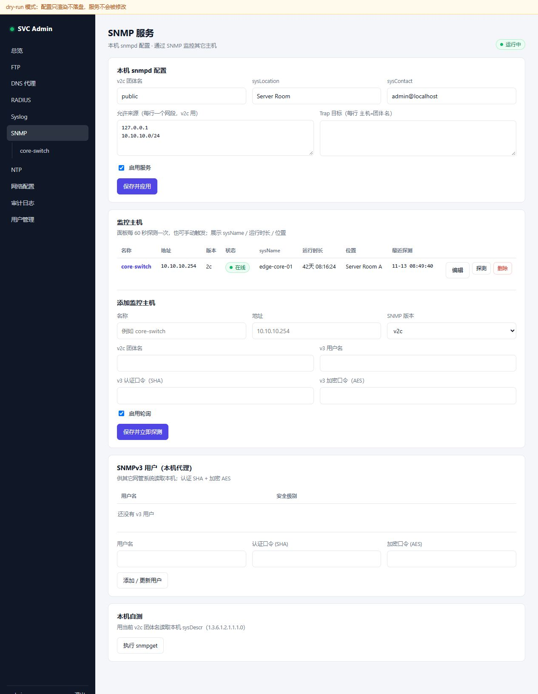](docs/screenshots/snmp.jpg) |
| **SNMP 主机详情**<br>系统信息、内存与 Swap、磁盘使用率、接口选择、1/6/24 小时流量趋势和统计。 | [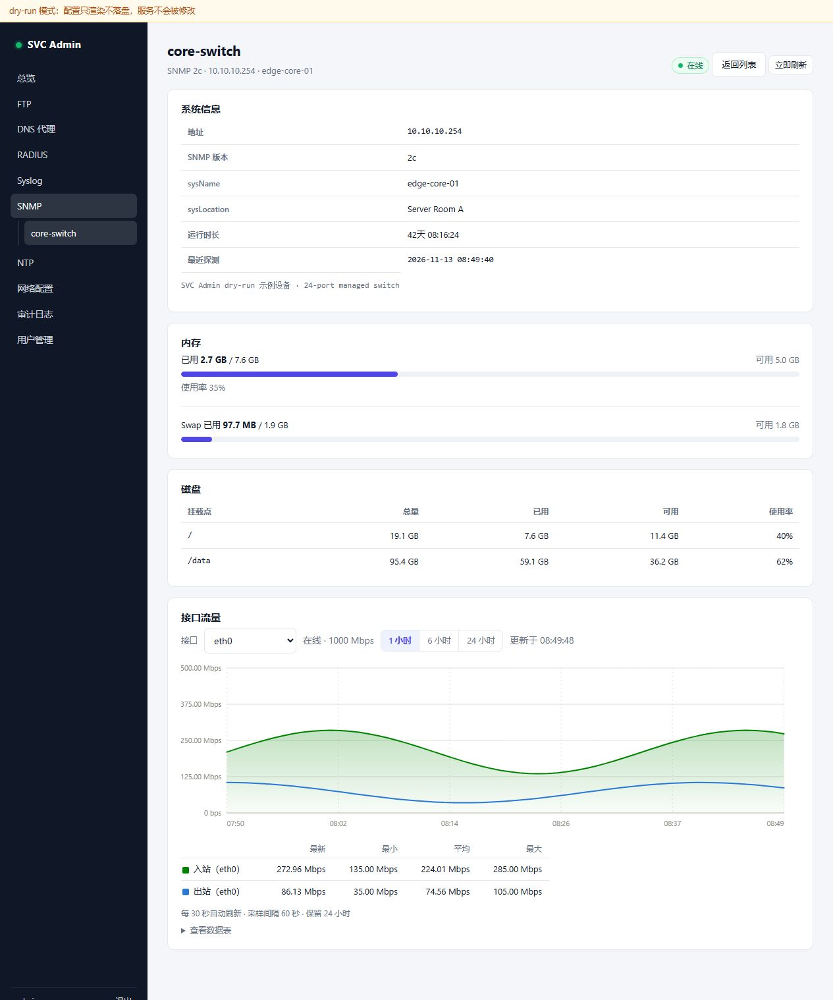](docs/screenshots/snmp-host.jpg) |
| **NTP 服务**<br>chrony 同步状态、Stratum、参考源、时间源列表、上游配置与授时网段。 | [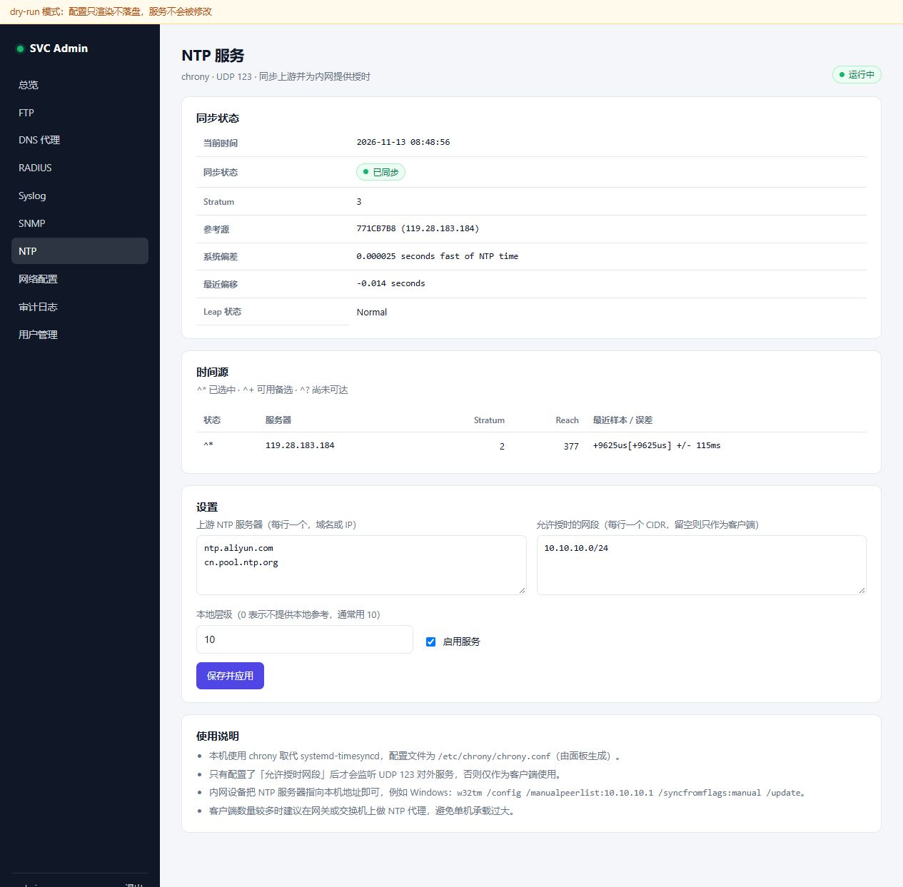](docs/screenshots/ntp.jpg) |
| **网络配置**<br>展示网卡、地址、路由和 DNS，支持 DHCP/静态地址以及 90 秒自动回滚。 | [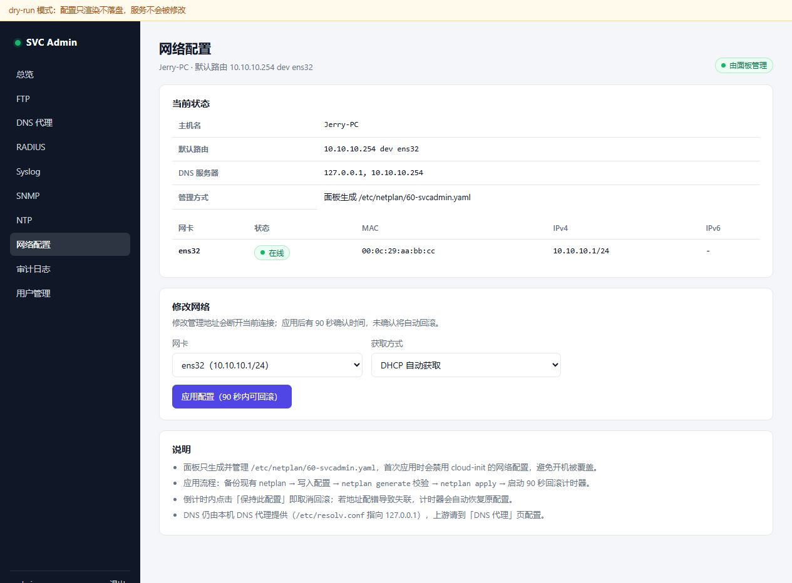](docs/screenshots/network.jpg) |
| **审计日志**<br>按服务筛选配置变更，记录时间、操作者、动作、详情和结果。 | [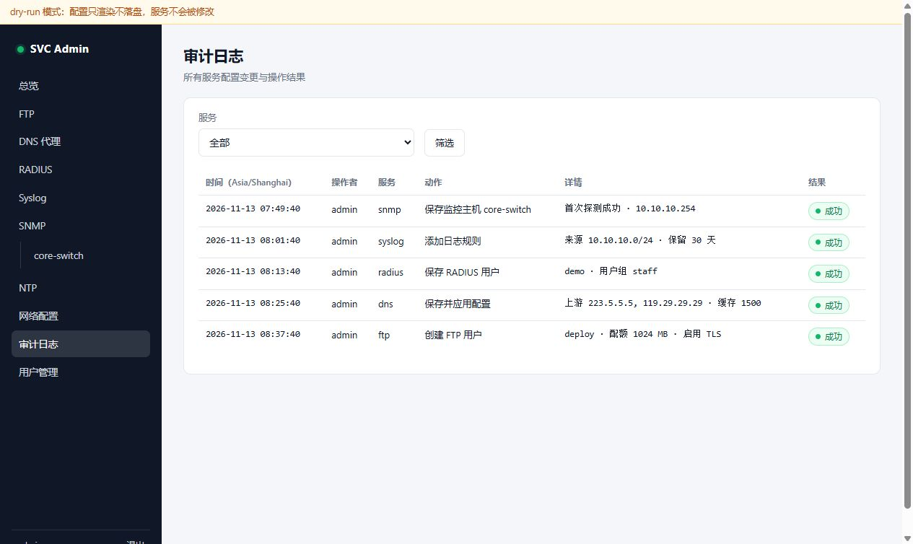](docs/screenshots/audit.jpg) |
| **用户管理**<br>添加账号、调整管理员/只读角色、重置密码，只读权限由服务端强制执行。 | [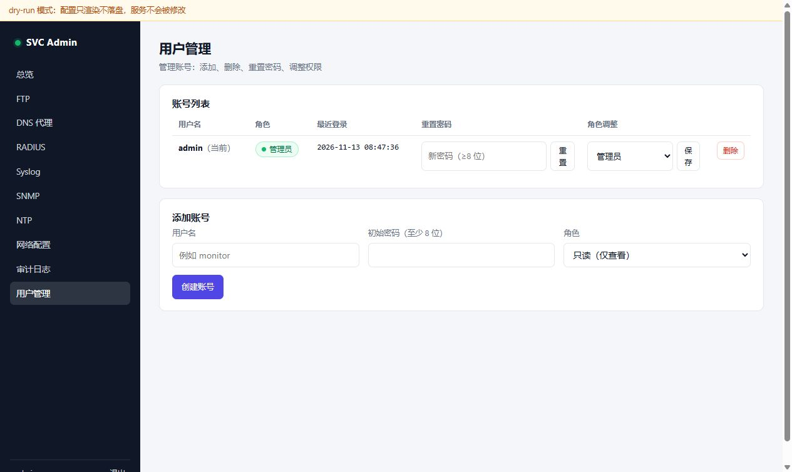](docs/screenshots/users.jpg) |

## SNMP 主机监控

在 SNMP 页的「监控主机」区域添加要监控的设备：填写名称、地址，选择 v2c（团体名）或 v3（用户名 + SHA 认证口令 + AES 加密口令）。

- 面板每 60 秒自动探测一次，也可在列表里点「探测」立即刷新；新增主机会立即探测一次。
- 展示状态（在线/离线）、sysName、运行时长、sysLocation、最近探测时间与失败原因。
- 左侧菜单 SNMP 下会自动列出所有主机，点击主机名进入**详情页**：系统信息、内存与 Swap（带使用率进度条）、磁盘（挂载点/总量/已用/可用/使用率）。
- **接口流量**是一个合并模块：接口选择 + 时间范围（1 / 6 / 24 小时）；绿色填充面积表示入站、蓝色线条表示出站，带时间轴网格、悬停十字线与提示框；下方是「最新 / 最小 / 平均 / 最大」统计和可展开的数据表，每 30 秒自动刷新。
- 速率按相邻两次轮询的计数器差值计算，历史保留 24 小时（`snmp_ifhistory`），页面按需降采样到最多 180 个点；采集依赖 `UCD-SNMP-MIB`（内存/磁盘，Linux 主机默认支持）、`HOST-RESOURCES-MIB`（备用）和 `IF-MIB`（接口），设备不支持时对应区块会显示"未采集到"。
- 详情页的「立即刷新」按钮仅管理员可用，只读账号看到的是后台轮询的最新数据。
- v3 口令保存在数据库中，页面不回显；编辑时留空表示保持不变。
- 面板主机需要能访问被监控设备的 UDP 161 端口。

## NTP 服务

面板「NTP」页使用 **chrony** 提供时间同步与对内授时：

- 上游服务器（每行一个域名或 IP）、允许授时网段（CIDR，留空则只作为客户端）、本地层级（默认 10）
- 展示同步状态（已同步 / 本地时钟 / 未同步）、Stratum、参考源、系统偏差，以及时间源列表（`^*` 已选中、`^+` 备选、`^?` 未可达）
- 面板生成并接管 `/etc/chrony/chrony.conf`；只有配置了允许网段才会监听 UDP 123，否则仅作为客户端
- chrony 会替代 systemd-timesyncd；首次启动或重启后通常需要几分钟才能与上游完成同步，期间以本地层级（Stratum 10）对外授时
- 内网设备把 NTP 服务器指向本机即可，例如 Windows：`w32tm /config /manualpeerlist:10.10.10.1 /syncfromflags:manual /update`
- 注意：chronyd 受 AppArmor 限制只能读取 `/etc/chrony/` 下的配置，面板的配置校验副本会放在该目录（校验后即删除）

## 账号与权限

- 登录账号分两种角色：**管理员**可查看并修改全部配置；**只读**账号可以查看所有页面与数据，但所有写操作都会被拦截（页面不显示表单，服务端也会拒绝 POST）。
- 所有账号都在同一个「用户管理」页处理：
  - 管理员：查看全部账号、添加账号、重置任意账号密码、调整角色、删除账号；系统始终保留至少一个管理员，且不能删除当前登录账号。
  - 只读账号：进入同一页面时只看到自己的账号，以及自己那一行的「修改密码」表单。
- 密码统一在用户列表每行修改（管理员重置他人、只读账号改自己的），至少 8 位，不再有单独的账号设置页。
- 修改角色后需要重新登录才生效（会话里保存了角色）。
- 初始管理员账号由安装脚本生成（`admin` + 随机密码），登录后请尽快在该页改掉。

## 架构

```
浏览器 ──HTTPS 443──▶ Nginx (TLS)
                        └─▶ uvicorn 127.0.0.1:8080  (svcadmin, FastAPI)
                              ├─▶ MariaDB 10.11  (svcadmin / radius / logs)
                              └─▶ sudo /usr/local/sbin/svcadmin-apply <service>
                                    备份 → 原子安装 → 校验 → 重启 → 健康检查 → 失败回滚
                                    ├─ dnsmasq
                                    ├─ pure-ftpd-mysql
                                    ├─ freeradius
                                    ├─ rsyslog
                                    └─ snmpd
```

权限边界：面板进程以 `svcadmin` 用户运行，只写入 `/var/lib/svcadmin/staging`；落地动作全部交给 root 所有的 `/usr/local/sbin/svcadmin-apply`，sudoers 只授权这一个二进制，且服务名与目标路径都在白名单内。

## 目录

```
/opt/svcadmin/app        应用代码（Python 包）
/opt/svcadmin/venv       虚拟环境
/etc/svcadmin/           环境变量与密钥（0600/0640）
/var/lib/svcadmin/       staging、备份（backups/<service>/<时间戳>）
/usr/local/sbin/svcadmin-apply   root 配置助手
```

## 部署

```bash
# 在目标机上传代码后
cd /root/svc-admin
sudo bash deploy/install.sh
```

安装脚本会：安装依赖包 → 建系统用户与目录 → 建 venv 装 Python 依赖 → 生成密钥 → 建库建表（含 FreeRADIUS 官方 schema）→ 配置 FreeRADIUS SQL 模块与 rsyslog AppArmor → 让出 53 端口（关闭 systemd-resolved stub）→ 生成两张自签证书 → 装 root 助手/sudoers/systemd/Nginx → 初始化管理员与五个服务的基线配置。

完成后输出面板地址与初始密码（`ADMIN_PASSWORD=...`）。浏览器首次访问需信任自签证书。

> SSH 隧道方式访问：`ssh -L 8443:127.0.0.1:443 root@<服务器>`

## 验收与本地开发

部署后在服务器上执行端到端验收（真实读写并自动清理测试数据）：

```bash
cd /root/svc-admin && bash deploy/verify.sh
```

覆盖：8 个 systemd 单元状态、面板 HTTP、DNS 解析、FTP/FTPS 登录、radtest 认证、远程日志入库、snmpget、NTP 授时。

本地开发（dry-run，不接触任何系统服务）：

```bash
python3 -m venv .venv && . .venv/bin/activate
pip install -r requirements.txt
python dev_server.py        # http://127.0.0.1:8099  演示账号 admin / devadmin123
```

## 时区

安装脚本统一把时区设为 **Asia/Shanghai（UTC+8）**，四个层面保持一致：

| 层面 | 设置方式 |
|---|---|
| 系统 | `timedatectl set-timezone Asia/Shanghai` |
| MariaDB | `/etc/mysql/mariadb.conf.d/99-svcadmin-timezone.cnf` → `default-time-zone = '+08:00'` |
| 面板 | `SVCADMIN_TIMEZONE`（写入 `/etc/svcadmin/svcadmin.env`），时间戳按该时区存储和显示 |
| rsyslog | 跟随系统时区；改时区后需 `systemctl restart rsyslog` 让进程重新读取 |

手工改时区时，上述四处要一起改，并且**重启长期运行的守护进程**（nginx、dnsmasq、pure-ftpd、freeradius、snmpd、rsyslog、svcadmin），否则进程会缓存旧时区继续按旧时间写日志。

## 总览仪表盘

首页展示服务器实时状态，每 10 秒自动刷新：

- 四个指标卡片：**CPU 使用率、内存使用率、磁盘使用率（/）、1 分钟负载**，各自带最近 15 分钟的趋势线；≥75% 标「偏高」、≥90% 标「过高」（负载按 CPU 核数判断）
- **网络吞吐曲线**：绿色面积 = 入站、蓝色线 = 出站，带时间轴、网格和当前速率
- 下方是五个服务的运行状态卡片与最近操作记录
- 后台每 10 秒采样一次写入 `system_sample` 表（保留 2 小时），页面通过 `/dashboard/system.json` 拉取

## 网络配置

「网络配置」页展示实时网络状态（网卡、MAC、IPv4/IPv6、默认路由、DNS），并可修改指定网卡的获取方式：

- **DHCP 自动获取**，或**静态地址**（CIDR + 网关，网关必须在该网段内）
- 应用流程：备份现有 netplan → 生成 `/etc/netplan/60-svcadmin.yaml` → `netplan generate` 校验 → `netplan apply` → 启动 **90 秒自动回滚计时器**
- 90 秒内在页面点「保持此配置」即取消回滚；如果新地址导致失联，计时器会自动恢复原配置（改管理 IP 也不会把自己锁在外面）
- 首次应用会写入 `/etc/cloud/cloud.cfg.d/99-svcadmin-disable-network-config.cfg`，避免 cloud-init 开机覆盖网络配置
- 只读账号只能查看状态，不能修改
- 权限边界：面板通过 sudo 只能调用 `/usr/local/sbin/svcadmin-net` 的 `apply|confirm|pending|show`；`rollback` 只能由 root 直接执行（systemd 计时器触发），sudo 被拒绝
- DNS 仍由本机 DNS 代理提供（`/etc/resolv.conf` 指向 127.0.0.1），上游在「DNS 代理」页配置

## 常用运维

```bash
systemctl status svcadmin nginx dnsmasq pure-ftpd-mysql freeradius rsyslog snmpd
journalctl -u svcadmin -n 100 --no-pager
python3 -m app.cli set-password --username admin --password '新密码'   # 在 /opt/svcadmin 下用 venv python
/opt/svcadmin/venv/bin/python -m app.cli prune-syslog --days 30
```

配置变更都可在 `/var/lib/svcadmin/backups/<service>/<时间戳>/` 找到上一版；面板应用失败会自动回滚。

## 端口

| 端口 | 用途 |
|---|---|
| 443 | 面板（Nginx，自签证书） |
| 21、39000-40000 | FTP / FTPS（被动端口段，与现有 UFW 规则一致） |
| 53 tcp+udp | DNS 代理 |
| 1812/1813 udp | RADIUS |
| 514 tcp+udp | Syslog 远程接收（可在面板关闭） |
| 123/udp | NTP 授时（配置了允许网段后监听） |
| 161 udp | SNMP |

安装脚本只在 UFW 处于启用状态时追加放通规则。

## 安全注意

- 面板是所有服务的管理入口，**只在内网/VPN 暴露**，不要直接映射到公网。
- 建议部署后修改 root 密码、禁用 root 密码登录、改用 SSH 密钥；面板管理员密码同样要强。
- 给监控同事开**只读账号**即可，只读角色在服务端拦截所有写操作，不用共享管理员密码。
- SNMP 被监控主机的 v3 认证/加密口令需要以明文存入面板数据库（探测时使用），请限制数据库访问。
- RADIUS 用户密码以 `Cleartext-Password` 存储（PAP/CHAP 认证的必要条件）；MariaDB 仅本机 socket 可连。
- FTP 用户为数据库虚拟用户，不使用系统账号；家目录固定在 `/srv/ftp/<用户名>`。
- 自签证书仅用于内网；有域名时可替换 `/etc/ssl/private/svcadmin.key` 与 `/etc/ssl/certs/svcadmin.crt`。

## 已知约束

- 面板修改的是它自己"拥有"的配置片段（`/etc/dnsmasq.d/svcadmin.conf`、`/etc/rsyslog.d/50-svcadmin.conf`、`/etc/snmp/snmpd.conf`、`/etc/pure-ftpd/` 下的选项文件），不会接管整份系统配置。
- dnsmasq 的 SIGHUP 只重读 hosts，不重读配置，所以面板一律用 restart 生效。
- FreeRADIUS 的 NAS 客户端只来自数据库 `radius.nas`（安装时已清空自带的 `clients.conf`），新增/修改后会自动重启服务。
- pure-ftpd 的证书路径是编译期固定的 `/etc/ssl/private/pure-ftpd.pem`，面板不提供修改入口。
- SNMPv3 口令变更通过重启时重建 `createUser` 生效（助手会清理 `/var/lib/snmp/snmpd.conf` 持久化文件）；v2c 团体名至少 4 位。
- rsyslog omysql 适合中小日志量；量级很大时应改用 Loki/ClickHouse 方案。
- 删除 FTP 用户会保留其家目录，避免误删数据。

## 故障排查

| 现象 | 排查 |
|---|---|
| 面板 502 | `systemctl status svcadmin`；`journalctl -u svcadmin -n 200` |
| DNS 不解析 | `systemctl status dnsmasq`；`ss -lunp \| grep :53`；确认 `systemd-resolved` 的 stub 已关闭（`/etc/systemd/resolved.conf.d/svcadmin.conf`） |
| 查询日志提示 Permission denied | `ls -l /var/log/dnsmasq.log` 应为 `dnsmasq:adm 0640`；`id svcadmin` 应包含 adm 组。安装脚本已自动处理，并配置了 logrotate 与 dnsmasq 的 `ExecStartPost` 兜底 |
| FTP 登录失败 | `journalctl -u pure-ftpd-mysql`；确认 `/etc/pure-ftpd/conf/MySQLConfigFile` 指向 mysql.conf 且 `auth/30mysql` 链接存在 |
| RADIUS 拒绝 | `freeradius -XC` 校验配置；`radtest` 手工测试；确认 `mods-enabled/sql` 与 `read_clients` |
| 日志不入库 | `aa-status \| grep rsyslog`；检查 `/etc/apparmor.d/local/usr.sbin.rsyslogd`；`journalctl -u rsyslog \| grep mysql` |
| SNMP 无响应 | `systemctl status snmpd`；`snmpwalk -v2c -c <团体名> 127.0.0.1`；确认来源网段 |

## 卸载

```bash
sudo bash deploy/uninstall.sh          # 停服务、删面板与助手，保留数据与数据库
```

## 数据备份

面板自身数据在 MariaDB（`svcadmin`、`radius`、`logs` 三个库）：

```bash
mysqldump --single-transaction --routines svcadmin radius logs | gzip > backup-$(date +%F).sql.gz
```
